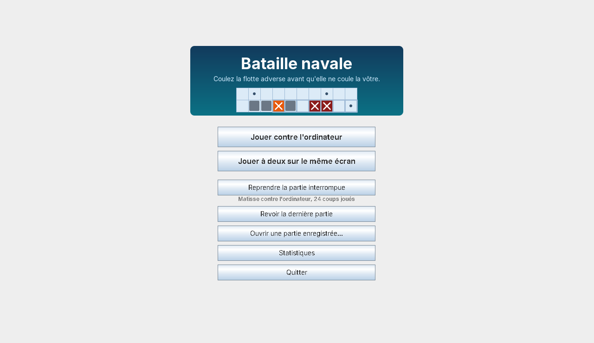
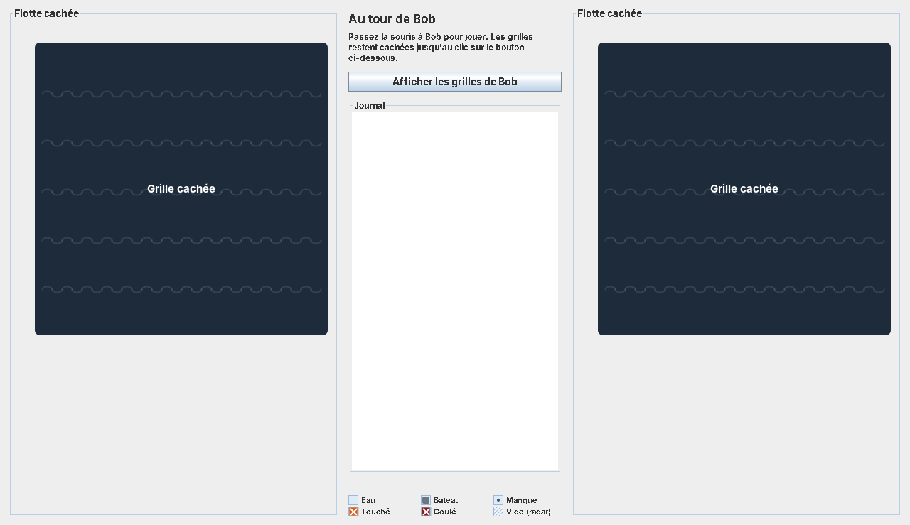
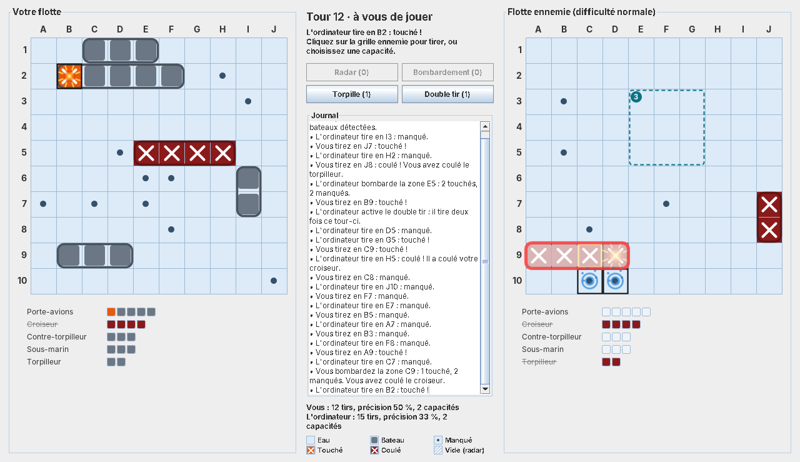
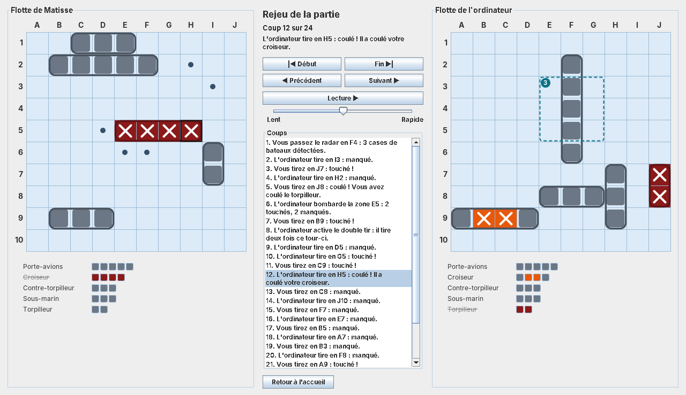

# Bataille navale

Jeu de bataille navale en Java, contre l'ordinateur ou à deux sur le même écran, dans une fenêtre Swing ou dans le
terminal.


## Fonctionnalités

- **Deux modes** : contre l'ordinateur, avec trois niveaux, ou à deux sur le même écran. À deux, les grilles se
  cachent entre les tours.
- **Capacités spéciales**, en option : radar, bombardement, torpille et double tir, une fois chacune par partie.
  L'ordinateur s'en sert aussi : bombardement et double tir au niveau normal, toutes au niveau difficile.
- **Placement à la main** : aperçu, rotation, reprise d'un bateau déjà posé pour le déplacer, annulation, placement
  du reste au hasard.
- **Suivi des deux flottes**, journal des coups, bilan des tirs, et animations désactivables (éclaboussure,
  explosion, naufrage, balayage du radar).
- **Sauvegarde automatique** après chaque coup : la partie interrompue se reprend depuis l'accueil, et la dernière
  partie se revoit coup par coup. Une partie peut aussi être enregistrée sous un autre nom, puis rouverte.
- **Statistiques** d'une partie à l'autre : victoires, séries, précision, durée, résultats par niveau, nombre de tirs
  pour couler chaque type de bateau une fois trouvé.
- **Bilan de fin de partie** : tirs, précision, et récit de la chasse de chaque bateau.
- Grille de 5×5 à 26×26, flotte classique (5 bateaux) ou rapide (3 bateaux). Les derniers réglages sont proposés à la
  partie suivante.

## Prérequis

- JDK 17 ou plus récent
- Maven 3.9 ou plus récent, pour compiler et lancer les tests

## Compiler et lancer

```bash
mvn package                                     # vérifie le style, compile, lance les tests, produit le JAR
java -jar target/bataille-navale.jar            # ouvre la fenêtre du jeu
java -jar target/bataille-navale.jar --console  # joue dans le terminal
```

Sans Maven :

```bash
javac -encoding UTF-8 -d build $(find src/main/java -name "*.java")
java -cp build bataille.Lanceur --console
```

## Règles

Chaque joueur place sa flotte sur sa grille, sans la montrer à l'adversaire. Les bateaux sont horizontaux ou
verticaux et ne se chevauchent pas ; ils peuvent se toucher.

| Bateau            | Cases |
|-------------------|-------|
| Porte-avions      | 5     |
| Croiseur          | 4     |
| Contre-torpilleur | 3     |
| Sous-marin        | 3     |
| Torpilleur        | 2     |

Les joueurs tirent chacun à leur tour sur une case de la grille adverse. Le résultat est annoncé : manqué, touché,
ou coulé quand toutes les cases d'un bateau sont touchées. Un tir sur une case déjà visée ne compte pas.
Le premier joueur qui coule toute la flotte adverse gagne.

### Capacités spéciales

Quand elles sont activées, chaque joueur peut utiliser chaque capacité une fois par partie, une seule par tour,
avant de tirer.

| Capacité     | Effet                                                                                          |
|--------------|------------------------------------------------------------------------------------------------|
| Radar        | Compte les cases de bateaux d'un carré de 3 × 3, sans dire où elles sont. Remplace le tir.     |
| Bombardement | Tire sur les 4 cases d'un carré de 2 × 2. Remplace le tir.                                     |
| Torpille     | Suit une ligne depuis la gauche, ou une colonne depuis le haut, jusqu'au premier bateau touché. Remplace le tir. |
| Double tir   | Donne deux tirs ce tour-ci.                                                                    |

Une zone où le radar n'a rien trouvé est hachurée sur la grille : inutile d'y tirer.

## Jouer

### Dans la fenêtre

L'accueil propose de jouer contre l'ordinateur ou à deux, de reprendre la partie interrompue, de revoir la dernière
partie, d'ouvrir une partie enregistrée et de consulter vos statistiques.

| Accueil                                        | À deux : la main passe                            |
|------------------------------------------------|---------------------------------------------------|
|    |      |

- **Placement** : survolez votre grille pour voir l'aperçu (vert : possible, rouge : impossible), cliquez pour poser
  le bateau, clic droit ou R pour le faire pivoter. Cliquez sur un bateau posé pour le reprendre. Quand la flotte est
  complète, « Valider la flotte » lance la partie.
- **Tir** : cliquez sur une case de la grille ennemie.
- **Capacité** : cliquez sur son bouton, puis visez sur la grille ennemie ; l'aperçu montre les cases visées.
  Clic droit ou R fait passer la torpille de la ligne à la colonne ; Échap annule.
- **À deux** : après chaque tour, les grilles se cachent. Passez la souris à l'autre joueur, qui clique sur
  « Afficher les grilles ». Il voit alors ce que vous avez joué.
- **Rejeu** : depuis l'accueil ou le bilan de fin de partie, revoyez la partie coup par coup, avec les deux flottes
  dévoilées.
- **Menus** : nouvelle partie (Ctrl+N), rejouer avec les mêmes réglages (Ctrl+R), ouvrir une partie (Ctrl+O),
  enregistrer la partie sous… (Ctrl+S), règles (F1) ; Options > Animations.

Chaque état de case a sa forme, pas seulement sa couleur : bloc gris pour un bateau, point pour un tir manqué,
croix sur fond orange pour une touche, croix sur fond rouge sombre pour un bateau coulé, hachures pour une case
vide d'après le radar.

| Animations                                         | Rejeu                                    |
|----------------------------------------------------|------------------------------------------|
|  |  |

### Dans le terminal

Un menu propose de jouer contre l'ordinateur ou à deux, de reprendre la partie interrompue et de voir vos
statistiques. Chaque question propose la réponse de la fois précédente : appuyez sur Entrée pour la garder.

| Commande        | Effet                                                         |
|-----------------|---------------------------------------------------------------|
| `B7`            | tirer en B7                                                   |
| `radar E5`      | radar sur le carré de 3 × 3 centré en E5                      |
| `bombe C3`      | bombardement du carré de 2 × 2 dont C3 est le coin haut gauche |
| `torpille 5`    | torpille sur la ligne 5 ; `torpille E` : sur la colonne E     |
| `double`        | double tir                                                    |
| `aide`          | rappeler les commandes                                        |
| `Q`             | interrompre la partie ; elle se reprend depuis le menu        |

- Placement à la main : la case de départ puis l'orientation, par exemple `B2 H` (vers la droite) ou `B2 V`
  (vers le bas) ; `annuler` reprend le bateau précédent, `hasard` place les suivants.
- Légende : `~` eau, `#` bateau, `o` manqué, `X` touché, `*` coulé, `-` vide d'après le radar.
- À deux, l'écran défile entre les tours pour cacher les grilles.

## Fichiers du jeu

Le jeu range ses fichiers dans le dossier `.bataille-navale` de votre dossier personnel ; l'option
`-Dbataille.dossier=<dossier>` en choisit un autre.

| Fichier                    | Contenu                                                     |
|----------------------------|-------------------------------------------------------------|
| `preferences.properties`   | animations, derniers réglages                               |
| `statistiques.properties`  | statistiques cumulées                                       |
| `derniere-partie.txt`      | la dernière partie, enregistrée après chaque coup           |
| `parties/`                 | dossier proposé pour « Enregistrer la partie sous… »        |

Une partie enregistrée est un fichier texte lisible : les réglages, la place des bateaux au départ, puis un coup par
ligne (`coup=1 TIR B7`, `coup=2 RADAR E5`…). La reprendre, c'est rejouer ces coups.

## Organisation du code

| Package             | Rôle                                                                                  |
|---------------------|---------------------------------------------------------------------------------------|
| `bataille.modele`   | Grille, bateaux, tirs, capacités et ordres, sans entrée ni sortie                     |
| `bataille.partie`   | Le moteur `Partie` (tours, tirs, capacités, fin), ses événements, l'enregistrement et le rejeu, les bilans |
| `bataille.ia`       | Les stratégies de tir de l'ordinateur et son usage des capacités                      |
| `bataille.donnees`  | Les fichiers : parties enregistrées, statistiques, préférences                        |
| `bataille.console`  | L'interface en mode texte                                                             |
| `bataille.swing`    | L'interface graphique                                                                 |
| `bataille.Lanceur`  | Le point d'entrée : fenêtre, ou console avec `--console`                              |

La console et la fenêtre ne contiennent aucune règle : elles transmettent les ordres à `Partie` et affichent le
résultat. `Partie` émet un événement à chaque tir, bateau coulé, capacité, changement de tour et fin de partie ; la
fenêtre s'en sert pour ses animations.

## Tests et qualité

- `mvn verify` lance les tests JUnit 5 (moteur, capacités, IA, enregistrement, rejeu, statistiques, console) et
  vérifie le style avec Checkstyle (`checkstyle.xml`).
- Chaque push est vérifié par GitHub Actions (`.github/workflows/build.yml`).
- `.editorconfig` fixe l'encodage (UTF-8), les fins de ligne et l'indentation (4 espaces).
