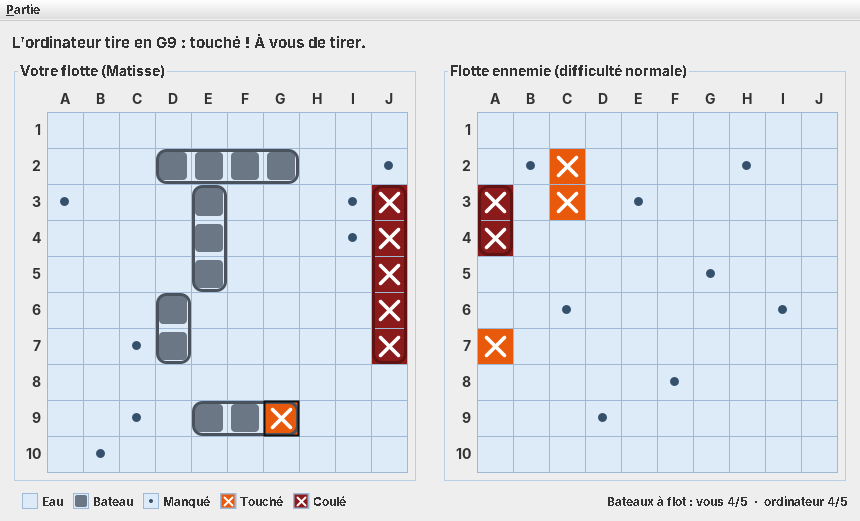

# Bataille navale

Jeu de bataille navale en Java : un joueur contre l'ordinateur, dans une fenêtre Swing ou dans le terminal.



## Fonctionnalités

- Deux interfaces sur un même moteur de jeu : fenêtre Swing ou console.
- Trois niveaux pour l'ordinateur : facile (tir au hasard), normal (chasse en damier puis cible autour des touches),
  difficile (carte de probabilités).
- Placement des bateaux à la main, avec aperçu et rotation, ou au hasard.
- Grille de 5×5 à 26×26, flotte classique (5 bateaux) ou rapide (3 bateaux).
- Bilan de fin de partie (nombre de tirs, précision) et option « Rejouer ».

## Prérequis

- JDK 17 ou plus récent
- Maven 3.9 ou plus récent, pour compiler et lancer les tests

## Compiler et lancer

```bash
mvn package                                     # vérifie le style, compile, lance les tests, produit le JAR
java -jar target/bataille-navale.jar            # ouvre la fenêtre du jeu
java -jar target/bataille-navale.jar --console  # joue dans le terminal
```

Sans Maven :

```bash
javac -encoding UTF-8 -d build $(find src/main/java -name "*.java")
java -cp build bataille.Lanceur --console
```

## Règles

Chaque joueur place sa flotte sur sa grille, sans la montrer à l'adversaire. Les bateaux sont horizontaux ou
verticaux et ne se chevauchent pas ; ils peuvent se toucher.

| Bateau            | Cases |
|-------------------|-------|
| Porte-avions      | 5     |
| Croiseur          | 4     |
| Contre-torpilleur | 3     |
| Sous-marin        | 3     |
| Torpilleur        | 2     |

Les joueurs tirent chacun à leur tour sur une case de la grille adverse. Le résultat est annoncé : manqué, touché,
ou coulé quand toutes les cases d'un bateau sont touchées. Un tir sur une case déjà visée ne compte pas.
Le premier joueur qui coule toute la flotte adverse gagne.

## Jouer

### Dans la fenêtre

- **Partie > Nouvelle partie** (Ctrl+N) : nom, niveau de l'ordinateur, taille de la grille, flotte, placement manuel.
- **Placement manuel** : survolez votre grille pour voir l'aperçu (vert : possible, rouge : impossible), cliquez pour
  poser le bateau, clic droit ou touche R pour le faire pivoter.
- **Tir** : cliquez sur une case de la flotte ennemie ; l'ordinateur répond aussitôt.
- Chaque état a sa forme, pas seulement sa couleur : bloc gris pour un bateau, point pour un tir manqué,
  croix sur fond orange pour une touche, croix sur fond rouge sombre pour un bateau coulé.

### Dans le terminal

- Une case s'écrit avec une lettre puis un nombre : `B7`. `Q` abandonne la partie.
- Placement manuel : la case de départ puis l'orientation, par exemple `B2 H` (vers la droite) ou `B2 V`
  (vers le bas) ; `hasard` place les bateaux restants.
- Légende : `~` eau, `#` bateau, `o` manqué, `X` touché, `*` coulé.

## Organisation du code

| Package             | Rôle                                                                     |
|---------------------|--------------------------------------------------------------------------|
| `bataille.modele`   | Grille, bateaux, tirs et règles de configuration, sans entrée ni sortie  |
| `bataille.partie`   | Le moteur `Partie` (tours, tirs, fin de partie), les joueurs, les bilans |
| `bataille.ia`       | Les stratégies de tir de l'ordinateur                                    |
| `bataille.console`  | L'interface en mode texte                                                |
| `bataille.swing`    | L'interface graphique                                                    |
| `bataille.Lanceur`  | Le point d'entrée : fenêtre, ou console avec `--console`                 |

La console et la fenêtre ne contiennent aucune règle : elles transmettent les tirs à `Partie` et affichent le
résultat.

## Tests et qualité

- `mvn verify` lance les tests JUnit 5 et vérifie le style avec Checkstyle (`checkstyle.xml`).
- Chaque push est vérifié par GitHub Actions (`.github/workflows/build.yml`).
- `.editorconfig` fixe l'encodage (UTF-8), les fins de ligne et l'indentation (4 espaces).
